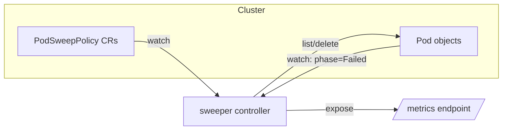
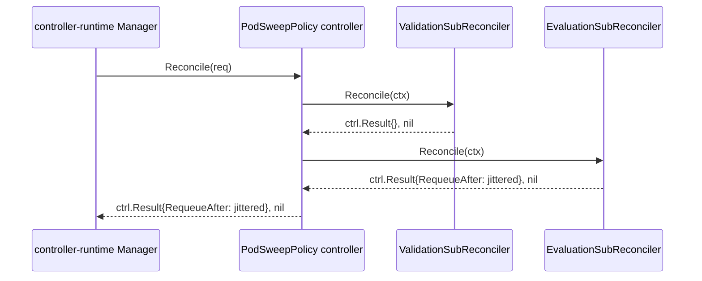

# Architecture: sweeper

See [`PRODUCT.md`](PRODUCT.md) for purpose and non-goals. See [`docs/adr/`](adr/) for the
rationale behind decisions marked (ADR-000N) below.

## Overview

`sweeper` is a single-binary Kubernetes operator built on `controller-runtime`. Its only
reconciled resource is its own CRD, `PodSweepPolicy` (ADR-0001); it does not reconcile `Pod`
objects directly, though it watches them to trigger re-evaluation.



## The `PodSweepPolicy` CRD

Cluster-scoped (it's a statement about cluster-wide pod hygiene, not owned by one namespace),
group `sweeper.omniva.com`, version `v1alpha1`, kind `PodSweepPolicy`.

```yaml
apiVersion: sweeper.omniva.com/v1alpha1
kind: PodSweepPolicy
metadata:
  name: stale-batch-pods
spec:
  namespaceSelector: {}   # metav1.LabelSelector; empty = all namespaces, subject to the
                          # protected-namespace gate below
  podSelector: {}         # metav1.LabelSelector; empty = all pods
  ttl: 1h                 # metav1.Duration; how long a pod may sit in Failed before it's
                          # eligible for deletion. A Go duration such as 72h, 1h30m or 500ms,
                          # greater than 0s; a day unit (1d) is not supported.
  mode: report            # enforce | report | disable — defaults to report if omitted
status:
  observedGeneration: 1
  conditions:
    - type: Ready
      status: "True"
    - type: Evaluated
      status: "True"
    - type: NamespacesSkippedProtected
      status: "False"
```

#### Conditions

| Condition | Set by | Reasons |
| --- | --- | --- |
| `Ready` | Validation | `Validated`, `Disabled`, `InvalidMode`, `InvalidTTL`, `InvalidNamespaceSelector`, `InvalidPodSelector`, `NamespaceListFailed` |
| `Evaluated` | Evaluation (and Validation for `NotReady`) | `Evaluated`, `Disabled`, `NotReady`, `NamespaceListFailed`, `PodListFailed`, `DeleteFailed` |
| `NamespacesSkippedProtected` | Validation | `ProtectedNamespacesExcluded`, `NoProtectedNamespaces`, `Disabled` |

`Ready` answers "is the spec valid and can the controller act on it". `Evaluated` answers "did the
last evaluation pass complete without error". A transition of either condition to `False` records
one Warning event with the same reason, except `NotReady` and `Disabled`, which are not failures.
`kubectl get podsweeppolicies` shows both as columns.

### Rule modes

Mode semantics are deliberately explicit, since this is the easiest thing to get subtly wrong:

| Mode      | Evaluated? | Metrics emitted? | Deletes pods? |
|-----------|:----------:|:-----------------:|:--------------:|
| `disable` | No         | No                 | No             |
| `report` (default) | Yes | Yes           | No             |
| `enforce` | Yes        | Yes                | Yes            |

- `disable` — the rule is not evaluated at all: no listing, no metrics, as if it didn't exist.
- `report` — the rule is evaluated (matching namespaces/pods are listed, the TTL cutoff is
  applied) and metrics are emitted for identified candidates, but **no delete calls are made**.
  This is the default so that installing a rule is always safe-by-default; an operator must take
  a deliberate action to start deleting anything.
- `enforce` — same evaluation as `report`, plus pods that have crossed their TTL are deleted, and
  the deletion counter increments.

### Identifying "evicted/failed" pods

A pod is a candidate if `pod.Status.Phase == v1.PodFailed` and it is not terminating
(`metadata.deletionTimestamp` is unset). This phase covers both kubelet eviction
(`pod.Status.Reason == "Evicted"`) and other terminal container failures under
`restartPolicy: Never`. A Failed pod that a finalizer holds (for example the Job tracking
finalizer) is already being deleted, so it is not sweeper's work and is not a candidate.

There is no single authoritative field for "when did this pod become Failed", so the "failed
since" timestamp is computed with this fallback order:

1. max of `containerStatuses[].state.terminated.finishedAt` across all containers, if any are
   terminated
2. else `pod.Status.StartTime`
3. else `pod.CreationTimestamp`

A pod becomes a deletion candidate once `now - failedSince >= spec.ttl`.

### No rules → no action

If zero `PodSweepPolicy` objects exist in the cluster, `sweeper` takes no action of any kind —
no listing, no deleting, no metrics beyond zero. This isn't a special-cased guard; it falls out
directly from the fact that all work happens inside `Reconcile(ctx, req)` for a specific
`PodSweepPolicy`, and with no such objects the reconcile loop is simply never invoked.

## Protected namespaces (operator-level gate)

Certain namespaces are protected regardless of what any individual rule's `namespaceSelector`
says. This is an **operator-level** invariant, not something a `PodSweepPolicy` author can
override:

- Default protected list: `kube-system`.
- Operator flag `--protected-namespace` (repeatable/comma-separated) overrides the default list
  entirely, for environments that need a different baseline.
- Operator flag `--allow-protected-namespace` (repeatable) explicitly unlocks specific namespaces
  from the protected list, so a cluster operator who really does want `sweeper` cleaning up
  `kube-system` pods can say so at the operator level.

When a rule's `namespaceSelector` would otherwise match a protected-and-not-unlocked namespace,
that namespace is excluded from evaluation for that rule. The exclusion is never silent: the
rule's `status.conditions` gets a `NamespacesSkippedProtected` entry and a Warning event is
recorded against the `PodSweepPolicy`.

## Sub-reconciler wiring

`sweeper` uses a sub-reconciler pattern (ADR-0002). The `reconciler.Reconciler` interface in
`internal/reconciler` is:

```go
type Reconciler interface {
    Name() string
    Reconcile(context.Context) (ctrl.Result, error)
    Delete(context.Context) (ctrl.Result, error)
}

type Watcher interface {
    Watches() []WatchFunc
}
```

The main controller's `Reconcile` is keyed on `PodSweepPolicy`. It manages the finalizer
`sweeper.omniva.com/finalizer`: a non-deleting policy that doesn't have it yet gets it added (and
the reconcile returns immediately, resuming on the `Update`-triggered requeue) before any
sub-reconciler runs. This guarantees `Delete` actually gets a chance to run cleanup — without a
finalizer, the API server could remove a `PodSweepPolicy` before any reconcile observes a live
`DeletionTimestamp`. Because only the controller removes the finalizer, the controller must
outlive the policies: uninstall deletes the policies first, otherwise they and the CRD stay in
`Terminating` (see [Uninstall](../README.md#uninstall)). On every subsequent call `Reconcile`
walks an ordered list of sub-reconcilers, calling `Reconcile` on each in turn (or `Delete` on all
of them, instead, when the `PodSweepPolicy` has a deletion timestamp), stopping at the first error
or the first non-zero `ctrl.Result`; once the `deleting` pass completes cleanly, the finalizer is
removed so the object can actually be deleted:



1. **`ValidationSubReconciler`** — resolves `spec.mode` (empty → `report`), parses
   `spec.namespaceSelector` and `spec.podSelector`, applies the protected-namespace gate to
   `spec.namespaceSelector`, and sets `status.conditions` accordingly. The format of `spec.ttl` (a
   positive Go duration), the `spec.mode` enum, and the `matchExpressions` operator and values
   arity of both selectors are enforced by the CRD schema at admission time; the `ttl` and selector
   rules use CEL validation, which needs Kubernetes 1.25 or later. The sub-reconciler re-checks
   `ttl > 0`, the `mode` value, and both selectors as defense in depth for objects stored before
   the schema rules existed and for selector errors CEL cannot see (such as an invalid label
   value). The selector checks run before the `disable` early return, so a disabled rule with a
   bad selector is reported too. On failure it sets `Ready=False` with reason `InvalidTTL`,
   `InvalidMode`, `InvalidNamespaceSelector`, `InvalidPodSelector`, or `NamespaceListFailed` (when
   the namespace List itself fails), sets `Evaluated=False/NotReady` because the chain stops here,
   records a Warning event on the transition, and returns an error so the object is requeued
   rather than silently keeping a stale `Ready=True`.
2. **`EvaluationSubReconciler`** — for the resolved (post-protected-namespace-gate) namespace and
   pod selectors: lists `Failed`-phase pods that are not terminating, computes failed-since +
   TTL-eligibility for each, updates the "currently identified" gauge, and — only when
   `mode == enforce` — deletes eligible pods and increments the deletion counter. Each delete
   carries a UID precondition (`client.Preconditions{UID: &pod.UID}`, no ResourceVersion), so a
   pod that was recreated with the same name after the cache read is never deleted. A `NotFound`
   or `Conflict` (the UID precondition failed) on delete means the evaluated pod is already gone:
   it is skipped, not counted, and does not fail the pass. It records the outcome in the `Evaluated` condition:
   `True/Evaluated` after a clean pass, `False` with `NamespaceListFailed`, `PodListFailed`, or
   `DeleteFailed` (and the error as the message) when a call fails, and `False/Disabled` in
   `disable` mode; a transition to a failure reason records one Warning event. The returned error
   and requeue behaviour do not change. It also implements `Watcher`, registering a watch on
   `v1.Pod` (filtered to `phase == Failed` transitions) mapped back to every `PodSweepPolicy`
   whose selectors could match it, via a controller-runtime field index, so a pod entering
   `Failed` triggers re-evaluation without waiting for the next poll.
3. **`Delete`** is a no-op on `ValidationSubReconciler`, and on `EvaluationSubReconciler` purges
   that policy's metric series — deleting a `PodSweepPolicy` only stops its evaluation; it must
   never cascade into deleting pods. The main controller's finalizer (above) is what guarantees
   this method is actually reached before the object disappears.

### Requeue

TTL expiry is time-based, not event-based, so the controller still needs periodic re-evaluation
even with the pod watch in place (a pod might already be past `failedSince` but the TTL only
elapses later, with no further pod event to trigger a re-check). `EvaluationSubReconciler`
computes:

```go
RequeueAfter = jitter.JitteredIntervalDuration(min(defaultPollInterval, timeUntilNextTTLExpiry))
```

using `internal/jitter` (ADR-0002).
`jitter.SetGlobalIntervalJitter` is configured once at manager startup with a named constant
(e.g. `requeueJitterPercent = 0.10`, not a magic number inlined at the call site).

## Metrics

Exposed on controller-runtime's standard `/metrics` endpoint (manager setup must not disable the
default metrics server, so the standard controller-runtime metrics — reconcile total/duration/
errors, workqueue depth — ship for free).

Custom metrics, both labeled by `namespace` and `policy` (the owning `PodSweepPolicy` name):

- `sweeper_evicted_failed_pods_current` (Gauge) — currently identified candidates at last
  evaluation. Terminating pods are not candidates, so they are not counted. Updated by `EvaluationSubReconciler` regardless of mode, **including `report`** —
  this is the metric an operator watches before flipping a rule to `enforce`.
- `sweeper_pods_deleted_total` (Counter) — cumulative successful delete calls. Only incremented
  in `enforce` mode. A pod that the cache already shows as terminating is not deleted or counted
  again, but a delete can repeat while the cache has not yet seen the pod's `deletionTimestamp`.

## Invariants

These must hold regardless of implementation detail; a code change that would violate one of
these needs to stop and either be redesigned or have this doc explicitly updated first:

- Must never evaluate or act on a `disable`d rule.
- Must never delete a pod outside `enforce` mode.
- Must never evaluate a protected namespace unless explicitly unlocked at the operator level via
  `--allow-protected-namespace`.
- Must never take any action (listing, metrics, or deletion) when zero `PodSweepPolicy` objects
  exist in the cluster.
- Deleting a `PodSweepPolicy` must never cascade into deleting the pods it was evaluating.

## Delivery

### Toolchain: mise

`mise.toml` pins Go, `controller-gen`, `golangci-lint`, `kind`, `kubectl`, `setup-envtest` (for the
envtest binaries unit tests need), and the release and CI tools (`oras`, `cosign`, `gitleaks`,
`actionlint`). CI installs the same pinned versions through `jdx/mise-action`, so local and CI
toolchains match.

### Tests

- **Unit tests** — `sigs.k8s.io/controller-runtime/pkg/envtest`, table-driven, one file per
  sub-reconciler plus dedicated tests for the protected-namespace gate and the failed-since
  algorithm.
- **e2e tests** — `kind`-based, under `test/e2e`: build the image, load it into a `kind` cluster,
  apply the CRDs and sample `PodSweepPolicy` objects, and assert on both `report` (pod survives,
  gauge increments) and `enforce` (pod is deleted, counter increments) behavior.

### CI (`.github/workflows/`)

`ci.yml` runs on every pull request and push to `main`, with these jobs: `lint` (`golangci-lint`
and `actionlint`), `gitleaks`, `build` (`make build`, then a check that generated files are
committed), `test` (`go test -race` via envtest), and `e2e` (spin up `kind`, run `test/e2e`).
`codeql.yml` and `scorecard.yml` add CodeQL and OpenSSF Scorecard analysis.

### Release pipeline

`release.yml` is triggered on a semver tag push (`v*.*.*`):

1. Build and push a multi-arch (`linux/amd64`, `linux/arm64`) application image to
   `ghcr.io/omniva-ai/sweeper`, tagged with the semver, with SBOM and provenance attestations.
2. Render the kustomize manifests and push them as a second OCI artifact,
   `ghcr.io/omniva-ai/sweeper-manifests`, tagged with the same semver (ADR-0003 records the
   exact mechanism).
3. Sign both artifacts keyless with `cosign`, using the workflow's GitHub OIDC identity.
4. Create a GitHub Release with the rendered manifests attached as `install.yaml`, so the release
   page has them directly downloadable without pulling the OCI artifact. Tags with a
   pre-release suffix (e.g. `v1.2.0-rc.1`) are marked as pre-releases.

## Deep dives

None yet — this hub stays the single canonical entry point. If a topic here grows enough detail
to need its own page (e.g. the failed-since algorithm's edge cases), add it under
`docs/architecture/` and link it here rather than expanding this file indefinitely.
